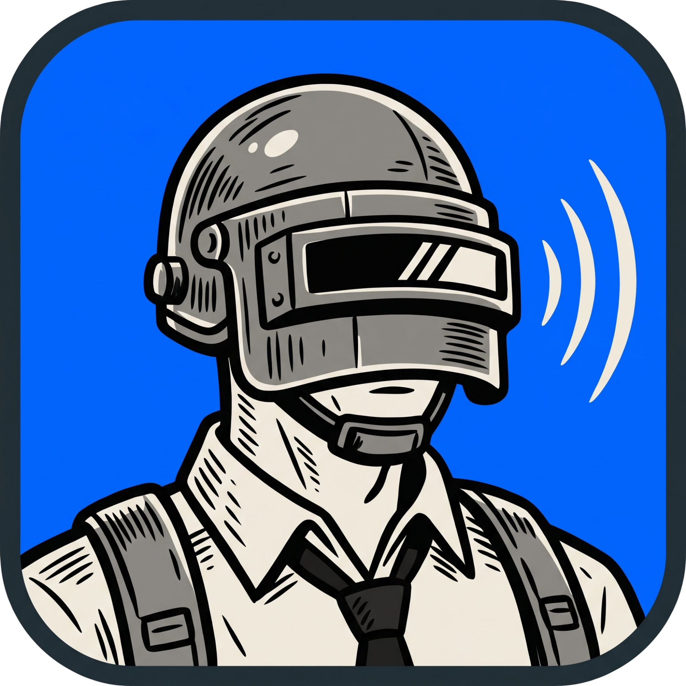

<div align="center">



# KuBooster

**Play Smooth. Stay Cool.**

*A lightweight, honest Android gaming performance companion for PUBG Mobile — by KUDUY*

[](https://github.com/gmsakibursabbir/kubooster/releases/latest)

<br/>

[](https://github.com/gmsakibursabbir/kubooster/releases)
[](#-installation)
[](#-installation)
[](https://github.com/gmsakibursabbir/kubooster/releases)
[](#-safety--anti-ban-policy)
[](#-safety--anti-ban-policy)

</div>

---

## 📖 About

KuBooster reads your device's **real** capabilities through public Android APIs, checks which PUBG Mobile variants are installed and at what version, recommends FPS targets and graphics presets that genuinely fit your hardware, and applies a small set of **reversible, user-confirmed system settings**.

It is built on one non-negotiable principle: **it never shows you a number it cannot verify.** Safe-mode features touch only reversible Android system settings. GFX mode (opt-in) edits PUBG's `UserCustom.ini` — the same change every GFX tool makes — always with an automatic, restorable backup and an explicit risk warning.

- ✅ Real device intelligence — CPU, GPU, RAM, display modes, thermal, battery
- ✅ Real game detection — 5 PUBG Mobile variants, exact version comparison
- ✅ Real FPS + graphics unlock — GFX mode with byte-exact backup and restore
- ✅ Real, reversible optimization — verified by read-back, restorable anytime
- 🚫 No fake "RAM cleaned: 2 GB" theater, no fake FPS promises

## ✨ Features

| | Feature | What it does |
|---|---|---|
| 🖥️ | **Device Diagnostics** | Full hardware report: CPU cores/ABIs, GPU renderer + OpenGL ES + Vulkan, RAM tier, Android/patch level. Unavailable values say *Unknown* with the reason. |
| 📱 | **Display Intelligence** | Current refresh rate vs. all advertised modes — kept strictly separate, because a 120 Hz panel ≠ 120 FPS gameplay. |
| 🎮 | **Game Detection** | PUBG Mobile Global (`com.tencent.ig`), **PUBG Mobile Flash** (`com.tencent.igfit`), Korea, Vietnam, BGMI (`com.pubg.imobile`) — with exact installed version. |
| 🚀 | **Boost Performance** | A confirmable flow that may set peak/min refresh-rate preference, brightness, battery saver and animation scale. Every change is **verified by read-back** and recorded for restoration. |
| ↩️ | **One-tap Restore** | Every change is journaled with its *original* value. Restore one change or all — always back to exactly what was there before. |
| 🎨 | **Graphics Presets** | Smooth Performance / Balanced / High Quality, tailored to your RAM tier and thermal state — applied by you inside PUBG's own settings menu. |
| ⚡ | **Shizuku (optional)** | Grants `WRITE_SECURE_SETTINGS` for battery-saver & animation controls via two compile-time-fixed commands. Every core feature works without it. |
| 🛠️ | **GFX mode (UserCustom.ini editor)** | The real FPS + graphics unlock: reads PUBG's `UserCustom.ini` through Shizuku (no root), sets frame rate (30/60/90/120) **and** graphics tier (Smooth / Balanced / HD / Ultra HDR), verifies the write byte-exact, keeps an automatic restorable backup, and one-tap resets everything back to the game's default. Works with PUBG Mobile **and** PUBG Mobile Flash. |
| 🎯 | **Game variant pinning** | Choose which PUBG Mobile flavor (Global / Flash / KR / VN / BGMI) the app targets, or leave it on Auto-detect. FPS & graphics guidance follow your pick. |
| 🔄 | **In-app updates** | Checks the official GitHub Releases for newer versions (toggle in Settings) and downloads the signed APK from `github.com` only. No analytics, no other servers. |

## 📲 Installation

**No root. No ADB. No PC.**

1. Go to [**Releases**](https://github.com/gmsakibursabbir/kubooster/releases)
2. Download the latest APK (e.g. `kubooster-v1.1.12-release.apk`)
3. Tap the file on your phone. If asked, allow **"Install unknown apps"** for your file manager
4. If Google Play Protect shows **"App scan recommended"** — that dialog appears for *every* app installed outside the Play Store, it is not a problem with KuBooster. Tap **"Install without scanning"** (or let it scan; both are fine — KuBooster has no ads, no analytics, and talks to github.com only)
5. Open KuBooster — onboarding runs real device detection immediately

> Updates install over the previous version without uninstalling (same signing key).

## 🚀 Quick Start Guide

### 1 · Onboarding
KuBooster reads your hardware, display modes, memory, thermal and battery state, and checks installed PUBG variants — everything stays on your device.

### 2 · Dashboard
Your device at a glance: current refresh rate, RAM, battery, thermal status, PUBG install status and compatibility confidence. Tap **Refresh** anytime.

### 3 · Boost Performance
Tap **Boost performance** → review the list of proposed changes (each one explains what it does and that it is reversible) → check only what you want → **Apply N changes**.

- Each result is labeled **Applied & verified**, **Applied, unverified**, or **Failed** — never a fake success
- Tap **Restore all KuBooster changes** to put everything back exactly as it was
- Items shown as *Unavailable* include the exact reason (e.g. "This device does not expose the standard refresh-rate preference key")

### 4 · FPS Profiles
See the honest state of each FPS option on **your** device:

| Label | Meaning |
|---|---|
| **Verified** | Documented for your game version in the bundled compatibility manifest |
| **Unverified** | Your display supports it, but game-side support is not documented yet |
| **Not supported** | Your display does not advertise this refresh rate |

> **A 120 Hz display does not mean 120 FPS gameplay.** The game renders FPS on its own — KuBooster never reports the display rate as game FPS.

**Want to force the game's options anyway?** Open **GFX mode** (5th tab). It edits PUBG's `UserCustom.ini` so the game itself offers higher frame rates — see the GFX section below.

### 5 · Graphics Optimizer
Pick a preset (Smooth / Balanced / Quality) and follow the concrete in-game settings shown for your hardware tier. **You apply them inside PUBG's own settings menu, once.** PUBG stores those settings itself — that's why they persist every time you reopen the game. KuBooster writes nothing into the game.

### 6 · Shizuku (optional)
Two extra controls (battery saver, animation speed) need a system-level permission. KuBooster shows the exact command it will run (`pm grant com.kuduy.kubooster android.permission.WRITE_SECURE_SETTINGS`) before asking. Skip it freely — the app is fully functional without it.

### 7 · GFX mode (the FPS unlock)

This is the feature that makes KuBooster a real GFX tool. It edits PUBG's own config file:

1. **Install & start [Shizuku](https://shizuku.rikka.app)** — free, no root. On Android 11+ you can start it via wireless debugging on the phone itself (no PC).
2. Open the **GFX** tab, pick your game (Global / Flash / KR / VN / BGMI).
3. KuBooster reads `Android/data/<pkg>/files/UE4Game/ShadowTrackerExtra/ShadowTrackerExtra/Saved/Config/Android/UserCustom.ini` through Shizuku and shows the game's **current frame-rate and graphics values**, decoded. Keys the game has never written show as *not set* — that's the game running on its own built-in defaults, not a read failure.
4. Pick **30 / 60 / 90 / 120 FPS** and optionally a graphics preset — **Smooth** (fewest effects, least lag on weak devices), **Balanced**, **HD**, **Ultra HDR**, or "Game's own" (frame rate only).
5. Read the warning, check *"I understand the risk"*, tap **Apply**.
6. The file is written through Shizuku and **verified by reading it back**. The untouched original is backed up in the app's private storage.
7. Fully close PUBG (also from Recent apps), start it, and pick the new options in the game's own settings.
8. **Remove GFX settings** — one tap writes the pristine file back byte-exact and everything returns to the game's default.

Technical detail: the `+CVars` values in `UserCustom.ini` are hex-encoded XOR-0x79; KuBooster decodes and re-encodes them natively (unit-tested against the published reference corpus), sets `r.PUBGDeviceFPSLow/Mid/High/HDR/UltraHDR` plus — when a preset is chosen — the standard quality CVars (`r.UserQualitySetting`, `r.ShadowQuality`, `r.MobileContentScaleFactor`, …), and leaves every other byte of the file untouched. Game updates can regenerate the file — apply again if needed.

## 🔐 Safety & Anti-Ban Policy

**The honest answer first:** no third-party app can promise 100% that an account will never be banned — bans are decided solely by Tencent/Level Infinite's anti-cheat. Anyone promising otherwise is lying to you.

KuBooster now has two clearly separated modes:

**Safe mode (default, system settings):**
- 🚫 No PUBG files are touched — boost, restore and graphics guidance work entirely on ordinary Android settings, reversibly and verified by read-back
- 🚫 **No gameplay automation** — no aim assist, no recoil tools, no injected code
- ✅ Graphics presets are applied by *you* inside PUBG's settings menu, the way the game intends

**GFX mode (opt-in, explicit, requires Shizuku):**
- 🛠️ Edits PUBG's own `UserCustom.ini` to set its frame-rate keys — the same category of change every GFX tool makes
- ⚠️ **Modified game configs are detectable by anti-cheat and accounts can be banned for it.** The app says this in a confirmation dialog that you must explicitly acknowledge before anything is written. No guarantee of any outcome is given or implied.
- ✅ The pristine file is backed up automatically before the first edit and can be restored **byte-exact** at any time
- ✅ Writes are verified by reading the file back — "applied" always means verified
- 🚫 The game is checked to be closed before any edit (it rewrites the config on exit)

Everything KuBooster does is audited in [`docs/SECURITY.md`](docs/SECURITY.md).

## 🛠️ Building from Source

Requirements: JDK 17, Android SDK (compileSdk 35, build-tools 35.0.0).

```bash
# Debug APK
./gradlew :app:assembleDebug

# Signed release APK (requires git-ignored keystore.properties — see docs/RELEASE.md)
./gradlew :app:assembleRelease

# Unit tests (20 JVM tests)
./gradlew :app:testDebugUnitTest
```

Artifacts land in `app/build/outputs/apk/{debug,release}/`.

## 📁 Project Structure

```
com.kuduy.kubooster
├── core/          dispatchers, design system (dark-first Material 3, Inter)
├── domain/        pure models + repository interfaces
├── data/          engines: device, display, game, compatibility, FPS,
│                  graphics, optimization, restoration, Shizuku
├── system/        audited Settings wrapper (compile-time key allowlist)
├── feature/       onboarding, dashboard, fps, graphics, diagnostics,
│                  shizuku, optimization, settings (Compose UI)
└── di/            explicit hand-written dependency graph
```

## 📚 Documentation

| Doc | Contents |
|---|---|
| [`docs/ARCHITECTURE.md`](docs/ARCHITECTURE.md) | Module layout, engines, design decisions |
| [`docs/SECURITY.md`](docs/SECURITY.md) | Privilege model, operation allowlist, prohibited behaviors |
| [`docs/COMPATIBILITY.md`](docs/COMPATIBILITY.md) | Manifest schema and verification policy |
| [`docs/TESTING.md`](docs/TESTING.md) | Test coverage + open on-device checklist |
| [`docs/RELEASE.md`](docs/RELEASE.md) | Signing and distribution |
| [`docs/PROJECT_STATUS.md`](docs/PROJECT_STATUS.md) | Current status and known limitations |

## ❓ FAQ

**Will my account get banned?**
KuBooster performs zero game modification, so it adds no ban risk from its own side. No app can control anti-cheat outcomes — be suspicious of any that claim otherwise.

**Does the GFX/FPS setting survive closing the game?**
Yes. The system-settings changes KuBooster makes (refresh-rate preference, animation speed, etc.) are **persistent Android settings** — they keep working across game sessions until you restore them. In-game graphics settings are set once inside PUBG and kept by the game itself.

**Is root or ADB required?**
No. Core features work with plain permissions. Shizuku (optional, no root needed) only unlocks two extra settings controls.

**How do in-app updates work?**
On launch (toggleable in Settings → Updates) the app compares its version with the latest GitHub release. Updates are downloaded through the system DownloadManager from `github.com` only and installed by Android's package installer — you confirm every step. The app never sideloads anything silently.

**Why do some Boost items show "Unavailable"?**
Honesty. E.g. many OEM skins don't expose the standard refresh-rate key — the app tells you that instead of pretending.

**Why are FPS options "Unverified"?**
The bundled manifest documents game-side FPS support only when real evidence exists. Display capability alone is never promoted to a game claim.

## ⚠️ Disclaimer

KuBooster is an independent utility by **KUDUY**. It is not affiliated with, endorsed by, or sponsored by PUBG Corporation, KRAFTON, Tencent, or Level Infinite. PUBG Mobile is a trademark of its respective owners. Use of the app is at your own discretion.

---

<div align="center">

**KUDUY** · *Play Smooth. Stay Cool.*

</div>
